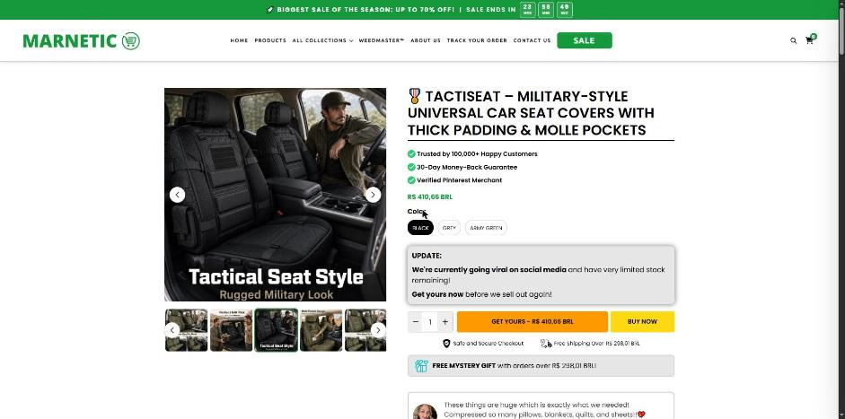
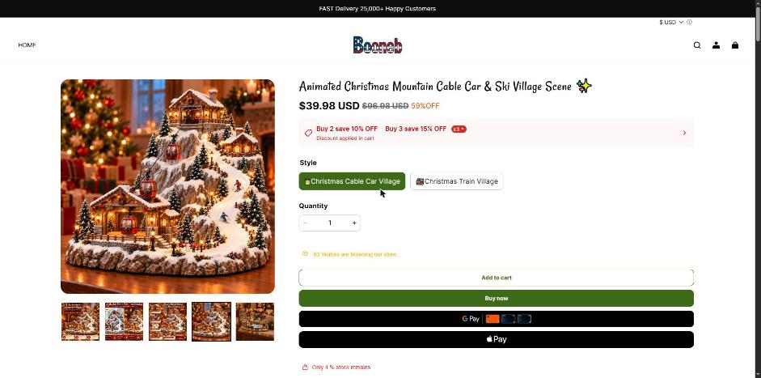

# Garimpo 3 — 23/11/2026 (método v3 + checagem de momento)

Quatro frentes em paralelo: presentes e gadgets, inverno/casa/carro, pets/beleza/carry, e preço do projetor de caça e do avião levitando. Cerca de 70 produtos olhados no freespyads, cruzados com Amazon e fornecedor, e os finalistas conferidos na Biblioteca de Anúncios (Chrome do Kenui).

Limites desta rodada: a cota diária do Ubersuggest (3 relatórios) acabou, então não há volume de busca dos finalistas. A CJ não abriu (falta permissão de leitura na extensão), então custo é estimativa, não cotação.

## Momento (EUA)
- Hoje 23/11. Thanksgiving 26/11, depois Black Friday/Cyber Monday: CPM no pico até o Natal.
- Prazo de entrega para o Natal: ~15/12. Com fornecedor nos EUA (3–7 dias), dá para vender até ~10/12.
- Janeiro: CPM mais barato, sai o presente e entra "inverno/neve/uso".

## 1. Capa de banco tática estilo militar (MOLLE, tamanho único) — RECOMENDADO

- freespyads: https://freespyads.io/products/military-style-auto-seat-protectors — 36 lojas, 1º anúncio 20/09/2026, novos anúncios por semana 4 → 24 → 145 → 737 (354 nos últimos 7 dias).
- Biblioteca (frase "tactical car seat"): ~260 resultados, lojas diferentes (Focoor, Scomeri, Nookti, Justaspiro, Zeebrify, Norbb, DallasWind, Optimisticn). Hailoyearn ativo desde 22/09 com 7 anúncios; Planvisi com 29 anúncios num criativo desde 12/11.
  - https://www.facebook.com/ads/library/?id=1127379103199088 (Hailoyearn, desde 22/09)
  - https://www.facebook.com/ads/library/?id=1464130295695799 (Planvisi, 29 anúncios)
- Lojas: https://marnetic.com/products/tactiseat-military-style-universal-car-seat-covers-with (US$68.90); aluckgoodup US$59.99 (página já saiu do ar).
- Amazon: QUGUJA US$35.99 sem avaliações https://www.amazon.com/dp/B0HKW9CS5B ; Youthify US$49.99, 4 avaliações. Nada barato com muitas avaliações.
- Custo: ~€10 (fornecedores listados no adsbench). Sem cotação CJ.
- Por que serve o ano todo: Natal (presente para pai/marido de picape) agora e, em janeiro, "proteger o banco de neve, sal, lama e cachorro". Público veterano/tático está em alta nos relatórios semanais.
- Riscos: dor moderada (vende mais pelo visual); cópias na Amazon a US$36 aparecendo; avaliações de uma loja são copiadas de outro produto (sinal de loja fraca, não do produto).
- Segurança: **média**. Duas provas de verdade presentes (anúncio ativo há 2 meses com variações + muitas lojas).

## 2. Vila de Natal com teleférico animado (resina, LED, música) — BOM SÓ ATÉ ~10/12

- freespyads: https://freespyads.io/products/animated-christmas-cable-car-village-scene — 28 lojas, 1º anúncio 21/10/2026, novos por semana 5 → 32 → 107 → 268 → 568 (dobrando).
- Biblioteca (frase "cable car" ski village): ~3.000 resultados. Parallelat-n com 346 anúncios num criativo desde 16/11; Retrospectdevelo 44; Declaredover desde 19/10.
  - https://www.facebook.com/ads/library/?id=2332852554227704 (346 anúncios)
  - https://www.facebook.com/ads/library/?id=1671462974326054 (44 anúncios)
- Lojas: https://booneb.com/products/animated-christmas-mountain-cable-car-ski-village-scene (US$39.98); https://avelunegoods.com/products/animated-christmas-ski-village-with-cable-car (US$53).
- Amazon: versão menor, uma gôndola, US$36.99 https://www.amazon.com/dp/B0H6M7TLCS ; XPSCOCO US$59.99 https://www.amazon.com/dp/B0H73VQJHP .
- Custo estimado US$14–20 entregue (fábrica parecida a US$10.60–11.50).
- Riscos: morre depois de ~15/12; resina quebra no transporte; muita gente entrando agora (40+ lojas somando listagens irmãs); entrega precisa ser dos EUA para chegar antes do Natal.
- Segurança: **média para venda rápida, baixa para operação duradoura**.

## 3. Avião levitando com pista LED — CONDICIONAL
- 21 lojas, 1º anúncio 05/11, US$35.99–39.99, subindo rápido. Não é brinquedo (sem CPSIA), ~500 g.
- Custo: só achei genérico no Alibaba a US$21–28 (55–65% do preço). Precisa de cotação CJ ≤ US$15 para passar.
- Segurança: **baixa** até ter cotação.

## Descartados nesta rodada
- Projetor de caça: sem SKU verificável da versão camuflada, a versão real custa ~100% do preço, é brinquedo infantil (CPSIA) e há relato de que o cliente recebe um projetor de slides genérico: https://wisdomganga.com/projector-hunting-game-scam-review/
- Guarda-chuva de corpo inteiro (escudo transparente): novo (13/11), mas Amazon já a US$24–25 e a marca original é BrollyPod. Segurança baixa.
- Pets: halo para cão cego e cama donut aquecida (tamanho, Amazon), projetores pet (novos demais, 92 lojas).
- Inverno/carro: aquecedor 12V e soprador turbo (Amazon US$18–24), carregador de bateria, secador de sapato (copia marca).
- Presentes: lagartixa que balança, karaokê, holograma de quintal, decanter, roupão aquecido (barato, infantil, vidro ou tamanho).

## Aprendizado
- Esta semana o que escala no freespyads é decoração de Natal de US$17–30. Gadget adulto de US$39–69 que começou entre set e nov é raro.
- Buscar na Biblioteca pelo nome da loja (ex.: "planvisi") acha os anúncios quando o texto do anúncio não tem a palavra do produto.
