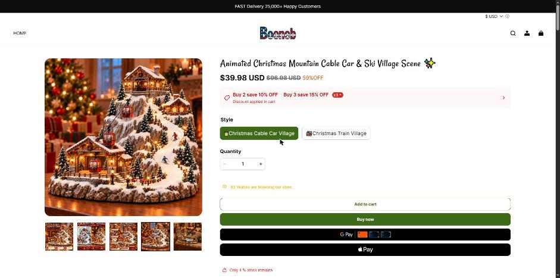

# Vila teleférico: dossiê v1 (23/11/2026)

Feito pelo agente Dossiê e copy (prompt v2), a partir do garimpo v3, do [material de estudo](estudo/material-de-estudo.md) e de pesquisa nova.
Legenda: **[certo]** vi na fonte. **[provável]** fonte única ou indireta. **[suposição]** leitura minha, a testar.

Quadros dos anúncios que escalam: [estudo/frames/](estudo/frames/).

## 1. Produto
- **O que é:** montanha nevada de resina com chalés acesos, duas gôndolas vermelhas num cabo e esquiadores descendo a pista. Luz LED quente, música natalina, cabo USB ou pilhas. **[certo]** pelas listagens.
- **Tamanho:** o molde dos anúncios aparece como **17 x 16,6 x 15 cm (6,7 pol)** na Amazon e no AliExpress. **[provável]** Ou seja: do tamanho de uma caneca grande deitada, não de uma peça de centro de mesa. Os anúncios, feitos com IA, fazem parecer bem maior.
- **Movimento:** gôndola e esquiador, um motor sob a base. **[provável]**; há versões com gôndola parada. Confirmar com vídeo real do fornecedor antes de prometer.
- **Preço praticado:** US$39,98 (Booneb), US$53 (Avelune), Amazon US$32,99 a 40,99 saindo da China. **[certo]**
- **Mecanismo verificável (por que encanta):** movimento contínuo e lento + luz quente no escuro. O olho humano é puxado por movimento na visão periférica; a peça "chama" quem passa pela sala. **[suposição]** apoiada no padrão das avaliações ("mesmerized", "loved all the lights and movement").
- **O que ela NÃO faz:** não decora a casa inteira; não é peça de colecionador de US$150+; não é robusta (resina, quebra na queda).

## 2. Mercado
- **Desejo de massa (Schwartz):** "quero que a casa pareça Natal sem ter que virar um projeto". Para presente: "quero dar algo que faça a pessoa sorrir quando liga".
- **Desejos básicos (Whitman):** conforto (aconchego), cuidar de quem ama (netos, mãe), aprovação social (visitas comentam).
- **Sofisticação:** estágio 3 indo para 4. Há 40+ lojas com o mesmo criativo de IA e a mesma promessa ("a tiny ski resort in your living room"). Promessa direta já não diferencia; o que diferencia é **ângulo e identificação** com uma pessoa específica.
- **Consciência:** varia por persona (ver [04-angulos.md](04-angulos.md)). Quem vê o anúncio no feed quase sempre não conhecia o produto: é público frio, de inconsciente a consciente do problema.

## 3. Voz real de compradores (literal, com origem)
Ainda são 38 frases, não as 100 do padrão. Faltam comentários de TikTok, YouTube e Reddit (não abriram nesta rodada). Ficam como lacuna da v2.

### Dor: decorar dá trabalho
1. "can be a pain to lug out, put up and put away" (HuffPost, 23/11/2026) https://www.huffpost.com/entry/easy-holiday-decorations-on-sale-black-friday_l_6b045afce4b0da866ee17c42
2. "If you always wished you could snap your fingers and the decorations were already live" (idem)
3. "I really don't feel the energy to decorate outside. Because I'm just to take it down in 3 weeks!" https://community.whattoexpect.com/forums/stay-at-home-moms/topic/feeling-bahhumbug-about-decorating-this-year-173566397.html
4. "Hubs has a busy work load this month so it's on me." (idem)
5. "I love decorating for holidays but sometimes life gets in the way" (avaliação citada no HuffPost)
6. "Truly the Xmas easy button!" (avaliação de árvore pronta, HuffPost)
7. "Downsized to condo... Lost most of my xmas stuff during move" (idem)
8. "spend weeks decorating, wrapping gifts, planning meals and trying to create a magical holiday" (mãe no Reddit, via Daily Dot, 18/11/2026) https://dailydot.com/mom-of-3-wonders-if-shes-wrong-to-scale-back-christmas-as-family-tensions-take-a-toll-on-her-marriage
9. "My husband and I are exhausted." (idem)
10. "putting up only a Christmas tree and keeping dinner simple" (comentário, idem)

### Dor: montar vila é obra
11. "You spend three hours wrestling with tangled wires." https://thelightshot.com/christmas-village-table-displays-why-your-setup-feels-off-and-how-to-fix-it-7z6
12. "part-interior designer, part-architect, and part-electrician" (idem)
13. "My biggest pet peeve of the whole village…the cords." http://sewmanyways.blogspot.com/2013/11/cordless-lights-for-christmas-village.html
14. "I hate fighting with all the cords....I get so frustrated by the time I'm done, I don't want to do anything else." (comentário, idem)
15. "I don't like getting mine out anymore because of those darned cords" (comentário, idem)
16. "it takes me the better part of a day to set-up. And, honestly, I dread the other day it will take to put it all away" https://debbeesbuzz.com/tour-magical-north-pole/
17. "In our 70's now, we began to think our village collections were just too much work to put up each year." (comentário, idem)
18. "Sadly, none of them were put out this year (it's a big job)." https://www.houzz.com/discussions/4343300/show-me-your-christmas-village
19. "It was so time consuming I decided to donate the whole thing" (idem)
20. "OK you guys are scaring me with your talking about how it's way too much work. i'm a very lazy person!" (idem)
21. "It just got too big and I didn't have the time to take it all out and put it up." (idem)
22. "someone to lie on the floor and connect it all!" https://www.martysmusings.net/how-to-create-a-christmas-village-display/
- Prova em vídeo: gente passando dias esculpindo montanha de isopor para a pista de esqui (TikTok @artsavanna, 290 mil views; @christmasvillagexperts). Links no estudo.

### Desejo e encanto
23. "My grandsons, ages 1 and 3, are mesmerized by it" (Amazon, versão parecida, citado no estudo)
24. "Loved all the lights and movement" https://www.fgsquarevillage.com/products/powder-ridge-resort
25. "It's the coolest, cutest little display and I can't wait for everyone to get to see it in action!" (idem)
26. "she puts up every year so I bought her this ski lift chalet and she loves it" (idem)
27. "P.S. the cats love too." (idem)
28. "It was better than I thought! Absolutely beautiful! Everyone loved it!" https://www.amazon.com/dp/B0CJLJ3PTK
29. "My daycare and family love it!" (idem)
30. "We gave this to my mom in assisted living and she loves it." https://www.amazon.com/dp/B09MDZ8RYR

### Presente para pais e avós
31. "The apartment is small. Vision isn't what it was." https://giftpodcast.com/en/blog/christmas-gifts-for-parents-in-assisted-living-2026
32. "makes the room feel like Christmas without becoming a project for anyone" (idem)
33. "'I don't need anything' is partly true and partly a protective reflex" (idem)
34. "give them something they couldn't have asked for because they didn't know it existed" (idem)
35. "the mother I always knew, the one that loved Christmas no matter what no longer had the heart for it" https://pammeboutselis.com/2023/01/01/remembering-mom-at-christmas/

### Medo e objeção
36. "I was very disappointed in the size of this Christmas decoration. It was so cute on the page, but is not in person" https://www.amazon.com/dp/B0CJLJ3PTK
37. "Showed up broken." https://www.fgsquarevillage.com/products/powder-ridge-resort
38. "The motors are also kind of loud, so if you don't mind the whining sound it's great." / "the music is tinny" https://www.amazon.com/dp/B0CJLJ3PTK
- Também no estudo: "pretty but very small", "I thought it was taller", luz falhando no 2º ano, elástico do teleférico difícil de encaixar.

### Como eles chamam o produto
"Christmas village", "ski lift", "ski slope", "cable cars", "little display", "the village", "mountain", "lift buckets", "set it up every year".

## 4. Concorrentes que anunciam (estrutura, sem copiar texto)
Detalhes e links no [estudo](estudo/material-de-estudo.md#1-anúncios-que-escalam-biblioteca-busca-exata-cable-car-ski-village-3100-resultados).
| Quem | Promessa | Ângulo | Prova | Oferta |
|---|---|---|---|---|
| Parallelat-n / Novtris (341 cópias, desde 16/11) | "a montanha ganha vida" | encanto, duas cenas em movimento | vídeo IA 13 s | loja, ~US$40 |
| Retrospectdevelo (44) | idem | lareira, aconchego | vídeo IA 15 s | idem |
| Unboxing (11) | "não mostre para quem ama..." | curiosidade + surpresa | mãos abrindo caixa, rosto | idem |
| Booneb | igual | igual | fotos IA, "25.000+ happy customers" sem prova | US$39,98 "de US$96,98", leve 2 com 10%, leve 3 com 15% |
| Avelune | "Christmas magic high in the mountains" | encanto + presente | texto longo, sem medida, sem foto real | US$53 "de US$84" |

**Buraco que ninguém ocupa [certo, nos 6 anúncios vistos]:** ninguém fala de dor, ninguém mostra a peça na mão (escala real) e ninguém fala com quem compra para a mãe ou avó.

## 5. Provas disponíveis (força, de Bencivenga)
| Prova | Temos? | Força | Promessa máxima que autoriza |
|---|---|---|---|
| Vídeo real da peça funcionando (fornecedor) | **Não ainda** | alta | "as gôndolas sobem, os esquiadores descem" |
| Vídeo IA de pessoa testando, com escala real | Podemos gerar | média | mostrar o que a peça faz, sem dizer que comprou |
| Especificações (medida, USB, chave de música) | Parcial | média | "17 cm, cabe numa prateleira, liga no USB" |
| Avaliações reais deste molde | **Não** (zero avaliações) | — | nenhuma; não usar avaliação |
| Dor pública de montar vila (vídeos de isopor, fóruns) | Sim, de terceiros | contexto | "montar vila dá trabalho" é fato público; não usar o vídeo deles |

## 6. USP honesta (por que aqui e não na Amazon)
Fraca hoje. A Amazon tem o mesmo molde a US$33 com a confiança da Amazon. O que podemos ter de verdade:
- **Medida honesta e vídeo real** (ninguém mostra; reduz reembolso).
- **Entrega garantida antes do Natal ou reembolso** (só se o fornecedor permitir).
- **Embalagem reforçada e reposição se chegar quebrado**, dito em voz alta.
- Kit de presente (2 unidades: uma para casa, uma para a mãe).
Se nada disso for possível, a USP é só o anúncio chegar antes da Amazon na cabeça da pessoa.

## 7. Mapa de objeções
| Objeção | Resposta | Bloco da página |
|---|---|---|
| "É menor do que parece?" | Sim, é pequena. Medida em centímetros + foto ao lado de uma caneca. Vende como "um cantinho", não "centro de mesa". | `demonstracao`, `objecoes` |
| "Vai chegar quebrado?" | Espuma moldada; foto da caixa; reposição grátis com foto do dano. | `envio`, `garantia` |
| "Chega antes do Natal?" | Prazo real em dias úteis e data-limite de pedido no topo. | `hero` (faixa), `envio` |
| "A música é chata?" | Chave separada: dá para deixar só luz e movimento. | `objecoes` |
| "Precisa de tomada perto?" | USB ou pilhas. | `mecanismo` |
| "É golpe de loja de drop?" | Nome e e-mail reais, política clara, nada de contador falso nem "de/por" inventado. | rodapé, `garantia` |
| "Por que não na Amazon?" | Ver USP. | `oferta-kits` |

## 8. Ideia central (uma frase)
**"Um canto da casa com cara de Natal em 30 segundos: é só ligar e a montanha se mexe sozinha."**
Variações por persona em [04-angulos.md](04-angulos.md).

## Lacunas para a v2
- Chegar a 100+ frases (TikTok, YouTube, Reddit, comentários dos anúncios).
- Vídeo real e medida do fornecedor.
- Volume de busca EUA (Ubersuggest sem cota hoje).
